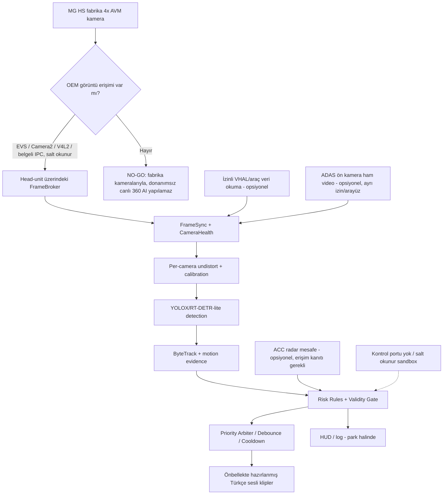

# ONUR DRIVE AI — MG HS 2023 / Tam Teknik Plan

**Sürüm:** 1.0 · **Tarih:** 17 Ekim 2026 · **Durum:** Araştırma ve mimari tamamlandı; araç üzerindeki donanım/yazılım arayüzleri henüz ölçülmedi.

> **Gerçeklik sınırı:** Hiçbir ilave araç donanımı, MG desteği, üretici anahtarı, ECU/ADAS müdahalesi olmadan, 2023 MG HS'nin dört fabrika kamerasının yüksek hızda kesintisiz okunabileceği **kamusal belgelerle kanıtlanmış değildir**. Bu belge çözümü garanti edilmiş gibi göstermiyor: gerekli ölçümler, bütün sonuç durumları ve her durumda devam/durdur kararları kapalı bir akışla tanımlanıyor. Eğer OEM video kaynağı gerçekten hızda kapanıyorsa veya erişim yetkisi yoksa, belirtilen bütün kısıtlarla hedef teknik olarak gerçekleşmez.

## 0. Kesin ürün tanımı ve değişmez koşullar

| Kod | Kural |
|---|---|
| R-01 | Hedef araç: Türkiye 2023 MG HS benzinli, fabrika 360° AVM, öndeki araca göre hız uyarlayan ACC. |
| R-02 | Kalıcı yeni kamera, kutu, kart, kablo, sensör, OBD dongle veya ayrı işlemci eklenmeyecek. Geliştirme bilgisayarı geçici araç dışı laboratuvar aracıdır; araçtaki ürünün parçası değildir. |
| R-03 | MG/SAIC ile yazışılmayacak; kamuya açık bilgi ve araçta önceden var olan izinli arayüzler araştırılacak. |
| R-04 | Fren, gaz, direksiyon, ACC, ADAS, radar, CAN, ECU/TCU/AVM yapılandırmasına **sıfır yazma**; güvenlik limitini değiştiren işlem yok. |
| R-05 | Hedef: sürücüye Türkçe, kısa, koşula bağlı **bilgilendirici** uyarılar. "Önün boş, ilerle" gibi sürüş onayı üretme yok. |
| R-06 | AVM ekranını yüksek hızda açık tutmak bir ürün gereksinimi değil; hedef, **erişilebilir ve izinli ham akışın** hareket boyunca sürekliliği. OEM ekran hız sınırı aynen kalır. |
| R-07 | Görüntü veya sensör akışı kesilirse sistem durumu `UNAVAILABLE`; bu kaynağa dayanan hiçbir yeni uyarı üretilmeyecek. |
| R-08 | Telefon/Android Auto bir sensör kaynağı sayılmayacak. İstenirse yalnızca araçta zaten bulunan bağlantı/ses kanalı olarak kullanılabilir; bu da doğrulanmış arayüze bağlı. |
| R-09 | Trafikte prototip sürüş yönlendirmesi yok. Test sırası: çevrimdışı veri → simülasyon → kapalı/ayrılmış alan → gözetimli kullanım değerlendirmesi. |
| R-10 | Tüm kesinlikle bilinmeyen donanım ayrıntıları açıkça `UNVERIFIED`; başka MG modelinden bilgi kopyalanmaz. |

## 1. Kanıt envanteri (araştırma sonuçları)

**K1 · Türkiye MG HS kullanıcı kılavuzu:** 360° sistem park yardımına odaklı. İleri vites ve **15 km/s veya üzeri** hızda 360° görüntü işlevi engelleniyor. Bu, ekran/kullanıcı işlevinin sınırı; **fiziksel kamera sensörlerinin yüksek hızda mutlaka akış kesmesi anlamına gelmez**. Kaynak: https://www.mg-turkey.com/upi/file/mg-hs-kullanici-el-kilavuzu.pdf

**K2 · Model/ülke ayrımı:** Bazı MG HS/PHEV belgelerinde HD AVM için 30 km/s ve bazı varyantlarda 20 mph ifadeleri var; farklı yıl/pazar/sistem sürümü birbirine karıştırılamaz. Kaynak: https://www.scribd.com/document/764970002/Mg-Hs-Owners-Manual ve https://www.notice-facile.com/en/manual/1411098/mg%2Bhs-plug-in-hybrid-2023

**K3 · MG HS devre şeması dizini:** 2019 MG HS şema dizininde sürüş yardımı, `S80 360° Panoramic Image`, `S81 Rear Camera`, öne bakan kamera modülü ve multimedya sistemleri ayrı başlıklarda yer alıyor. Bu donanımın araç içinde ayrı mantıksal sistemlerle işlendiğini destekler; 2023 aracının kesin pinout'unu doğrulamaz. Kaynak: https://en.17vin.com/automotive_repair_manual_wiring_diagrams/MG/6257.html

**K4 · MG4 açık kaynak deneyimi:** MG4-360-Camera-App, belirli MG4 AAOS sürümlerinde `/dev/video14..17` gibi V4L2 düğümlerinden görüntü alıyor; native JNI/OpenCV katmanı kullanıyor ve üretici ekranı hız kapanışı dışında görüntü sunabiliyor. `V4L2` düğümlerinin MG HS'de de varlığı ve erişilebilirliği **kanıt değil**, yalnızca arama hipotezi. Kaynak: https://github.com/jamakr4/MG4-360-Camera-App ve https://github.com/jamakr4/MG4-360-Camera-App/wiki/How-to-get-access-to-the-camera-feed

**K5 · Android Automotive resmi arayüzleri:** EVS/HAL, OEM araç kameralarının sistem tarafındaki olası görüntü arabirimlerinden biri. EVS, sistem/ayrıcalıklı bileşen yetkileriyle sınırlandırılabilir; normal Android uygulamasının bunu görebileceği garanti değil. Kaynak: https://source.android.com/docs/automotive/camera/evs/camera-hal ve https://source.android.com/docs/automotive/camera

**K6 · Araç verileri:** Android Automotive VHAL, araç özelliklerini kontrollü şekilde sunabilir; üretici hangi özellikleri açmışsa erişilebilirlik ona bağlıdır. Kaynak: https://source.android.com/docs/automotive/vhal ve https://source.android.com/docs/automotive/security/vehicle_system_isolation

**K7 · 2023 HS yazılım çeşitliliği:** 2023 HS için mühendislik menüsüne girme yollarının farklı olduğuna ilişkin kullanıcı raporu var. MG4 için açıklanan parola, ADB, uygulama kurulum tekniği doğrudan HS'ye taşınmayacak. Kaynak: https://www.pakwheels.com/forums/t/mg-hs-2023-engineering-mode/3007540

**K7b · HS sahiplerinden Android/kurulum kanıtı (düşük güven):** XDA'da MG HS Pilot için Desay SV Android tabanlı multimedya birimi olduğunu söyleyen fakat APK yükleyemediğini belirten sahip raporu var. Bu, araç ailesinde Android bulunduğu olasılığını destekler, ancak senin 2023 Türkiye yazılım sürümünde SDK/ADB/video izni bulunduğunu doğrulamaz. Kaynak: https://xdaforums.com/t/saic-mg-hs-pilot-android-unit-desay-sv.4664561/

**K8 · Açık kaynak yazılım lisansları:** YOLOX Apache-2.0; RT-DETR Apache-2.0; ByteTrack MIT; ONNX Runtime MIT; OpenCV 4.5+ Apache-2.0; Chatterbox yazılımı MIT ve Türkçe destekli. *Model ağırlıkları/dataset/örnek sesler ayrıca denetlenmeli.* Kaynaklar: https://github.com/Megvii-BaseDetection/YOLOX ; https://github.com/lyuwenyu/RT-DETR ; https://github.com/FoundationVision/ByteTrack ; https://github.com/microsoft/onnxruntime ; https://opencv.org/license/ ; https://github.com/resemble-ai/chatterbox

### Kanıt düzeyleri

- **DOĞRULANDI (model dokümanı):** MG HS'de 360° kullanıcı ekranının hıza bağlı engellenmesi; ACC/ADAS'ın varlığı kullanıcı beyanıyla teyitli.
- **BENZER MODELDE GÖSTERİLDİ:** MG4'te V4L2/raw kamera akışına OEM arayüzünün dışında erişim.
- **2023 HS İÇİN DOĞRULANMADI:** Uygulama yükleme yetkisi, işletim sistemi, OEM raw stream, AVM çıkış protokolü, yüksek hızda stream sürekliliği, ACC/radar sayısal takip mesafesi.

## 2. Mimarinin tek onaylı biçimi



**Yerleşim:** Nihai in-car uygulama yalnızca mevcut multimedya biriminde koşar; `FrameBroker` doğrudan araç işletim sistemi arayüzünden kare alır. GPU/NPU/CPU gerçek kapasite testi geçilmezse, *ek donanım yok* şartında yüksek performanslı canlı çıkarım vaadi verilemez.

### Veri sözleşmeleri

`CameraFrame {camera_id, t_mono_ns, width, height, pixel_format, calibration_id, frame_age_ms, validity, buffer_ref}`

`VehicleState {t_mono_ns, speed_kmh?, gear?, indicators?, acc_enabled?, source, quality}` — **soru işareti** kaynağa göre opsiyoneldir.

`Track {id, class, cam_id, bbox, track_age, confidence, ground_contact?, motion_vector?, uncertainty}`

`RiskEvent {event_type, severity, evidence, t_mono_ns, expires_ms, confidence, source_quality}`

`Alert {id, phrase_id, severity, emitted_at, cooldown, audio_file}`

Kod gereği `unknown` değerleri `0`, `false` veya `safe` diye yorumlanmaz.

## 3. Donanım eklemeden araçla ilk temas — salt okunur tanılama

**İlke:** Araç PARK durumunda, güvenli alanda, motoru çalıştırma gerektirmeyen koşullarda, yalnızca kullanıcının normal görebildiği ekran bilgilerinden başla. Bu aşamada *engineering mode ayarı değiştirme, firmware update, root, güvenlik yetkisi aşma, pin bağlama, CAN yazma* yok.

1. Normal UI'dan `Model/Trim`, `System Information`, yazılım ve MCU sürümü, ekran platformu bilgileri; kullanıcı arayüzünden ekran görüntüleri. Kişisel veriler ve VIN redakte edilir.
2. Normal ayarlarda açılabiliyorsa **üretici tarafından sunulan** geliştirme/USB hata ayıklama seçeneğinin varlığı not edilir; mevcut değilse etkinleştirme amacıyla bilinmeyen kodlar denenmez.
3. Geliştirme cihazıyla standart/izinli ADB bağlantısı **zaten yetkilendirilebiliyorsa**, aşağıdaki salt okunur keşif komutları uygulanır. ADB erişimi yoksa bu adım `ACCESS_DENIED` sonucuyla kapanır.
4. `getprop` ile OS ve ürün profili, `service list` ile kamera/araba servisleri, `/dev/video*` listelemesiyle olası V4L2 düğümleri, `dumpsys media.camera` ile arayüz envanteri. Hiçbir görüntü akışı bu adımda başlatılmaz.
5. Ortaya çıkan öğeler `hardware_profile.yaml` dosyasında `confirmed/unknown/denied` statüleriyle saklanır.

```bash
# YALNIZCA daha önce izinle etkinleştirilmiş ADB mevcutsa.
adb devices -l
adb shell getprop ro.build.version.release
adb shell getprop ro.build.fingerprint
adb shell getprop ro.product.model
adb shell getprop ro.hardware
adb shell getprop ro.product.carmode
adb shell service list
adb shell ls -l /dev/video\*
adb shell dumpsys media.camera
adb shell pm list packages
```

Bunlar normalde okuma işlemleridir; OEM yetki politikaları bazılarını engelleyebilir. `adb shell` ile bilinmeyen üretici servislerine komut vermek bu protokole dahil değildir.

## 4. Kamera arayüzü seçim algoritması — tam kapanan karar ağacı

| Dal | Giriş şartı | Doğrulama testi | Sonuç |
|---|---|---|---|
| C1 · EVS/Camera HAL | Android tabanlı birim; OEM izinli erişim | Listele → park halinde 10 s okunabilir stream → OEM AVM ile çakışma testi | Başarılıysa ana kamera adaptörü `evs`; başarısızsa C2 |
| C2 · V4L2 | İzinli `/dev/video*` ve capture capability | Önce sadece `QUERYCAP`/format listele; sonra kontrollü 10 s görüntü testi | Başarılıysa `v4l2`; başarısızsa C3 |
| C3 · Paylaşılan OEM akışı | OEM uygulamasının izinli/kararlı IPC/Surface arayüzü | Görüntünün ham kare mi, çizilmiş AVM UI mı olduğu doğrulanır | Geçerse `oem_ipc`; değilse C4 |
| C4 · Standart Camera2 | `CameraManager` kameralara erişim izni verir | Ham kare/senkron verisi ve OEM önceliği test edilir | Geçerse `camera2`; değilse C5 |
| C5 · Erişim yok | Yetki veya fiziksel akış kapalı | Sonuç `ACCESS_DENIED/NO_STREAM` kaydı | **NO-GO** — kısıtlar korunur, ileri sürüşte kullanılamaz |

**Not:** MG4'teki `/dev/video14..17` düğümleri **MG HS için pin/adres kabul edilmeyecek**. Çekirdek düğümlerinin mevcut olması video akışına yetkili erişim olduğunu kanıtlamaz.

### 360° hız eşiği testi (yalnızca izinli ve gözetimli, kapalı test tesisi)

Amaç: OEM arayüzünün kapandığı anda **arka plandaki erişilebilir ham akış** canlı kalıyor mu? Test cihazı OEM kameranın önceliğini bozmaz; OEM hız eşiği veya araç hızı sahteleştirilmez.

- E0: Araç dururken dört kamera için kare artışı, zaman damgası ve gecikme kaydı.
- E1: OEM arayüzü açık/kapalı iken ham akış sürekliliği (parkta).
- E2: Kontrol edilmiş test pistinde, **önceden tanımlı, yasal, uygun güvenlik koşullarında**, OEM kullanıcı arayüzü hız nedeniyle kapandığında ham frame sayacı ve kare yaşı izlenir. Gereken güvenli test koşulları sağlanamıyorsa E2 uygulanmaz.
- E3: Akış sürekli kalıyorsa `STREAM_CONTINUES`; duruyorsa `STREAM_STOPS`; yetki yoksa `ACCESS_DENIED`.
- **Karar:** `STREAM_CONTINUES` → yalnızca OEM limitleri korunarak uygulama-layer izleme; `STREAM_STOPS`/`ACCESS_DENIED` → **NO-GO**. Hiçbir CAN spoofing, sürat eşiği patch'i, firmware modifikasyonu veya geri vites sahtelemesi yapılmaz.

## 5. ACC/ADAS sensör verileri

ACC'nin araçta bulunması, üçüncü taraf uygulamaya **mesafe, hedef araç hızı veya radar objeleri** verdiğini kanıtlamaz. Sıra:

1. Head-unit'in zaten desteklediği **okunur** VHAL/CarService özelliklerini keşfet (salt okunur yetki); izin verilmeyen OEM alanlarına erişim yok.
2. Var olan UI olayları / sistem açıkça sunuyorsa `speed`, `gear`, `indicators`, `ACC state` sırasıyla eşleştir; her biri için doğruluk, gecikme ve kaynak kaydı.
3. `radar_distance` özelliği yalnızca **belgeli/izinli** bir sayısal kaynaktan geliyorsa açılır; aksi halde `NULL`.
4. Standard OBD-II haricî dongle gerektirir; kullanıcı şartı nedeniyle **ürün tasarımına dahil değildir**.
5. Doğrulanmamış ham CAN ID/PID tahmini, aktif diagnostik oturumu, ECU komutu, saldırı/kontrol gerektiren şema yok.

**Ön görüş ADAS kamerası** park için tasarlanmış ön AVM kamerasından farklıdır. Ayrı ve yetkili ham akış saptanırsa ikinci bir kamera adaptörü olabilir. Saptanmazsa şerit, uzak takip mesafesi ve yüksek hızda güvenilir TTC **desteklenmez**.

## 6. Bilgisayarlı görü / algılama seçimi

| Modül | Seçim | Operasyonel ayrıntı |
|---|---|---|
| Temel dedektör | YOLOX-Nano/YOLOX-Tiny, ONNX; alternatif RT-DETR-lite | Donanım benchmark'ına göre tek model kilitle. Lisanslar ve weight kaynağı pinle. |
| Takip | ByteTrack | Her fiziksel kamerada bağımsız tracker; çapraz kamerada aynı nesne varsayma. |
| Lens | OpenCV calib3d (fisheye) | Her görüntü için intrinsics + distortion + extrinsics; yoksa hassas mesafe/takip alarmı kapalı. |
| Geometri | Zemin teması + kalibrasyon + zamansal filtre | Kalibre edilmedikçe piksel mesafesinden "metre" türetme. |
| Uyarı mantığı | Deterministik rule engine | LLM karar vermez, tahmin tek başına komut değil. |
| Ses | Önceden render edilmiş Türkçe klip | Chatterbox Multilingual V3 ile **offline** hazırlanır; araç üzerinde TTS inference gerekmez. |
| Runtime | Native C++/Kotlin + ONNX Runtime Mobile | Araç içi OS ve izinli API doğrulanınca son paket formatı sabitlenir. |

**Uygulanacak güvenilir fonksiyonlar (kanıt kapılarıyla):**

- `PARK_OBJECT_ALERT`: düşük hız, yakın alanda statik/dinamik engel, en az 3 tutarlı kare, kamera sağlığı sağlıklı.
- `SIDE_OCCUPIED_INFO`: yan kamerada nesne varlığı, uygun görüş bölgesi, 3+ tutarlı kare; **kör nokta boş** garantisi verilmez.
- `FRONT_OBJECT_APPEARED`: ön AVM'de yeni nesne, konum yönü, temel bilgilendirme.
- `LEAD_MOVED`: **kalibre ve doğrulanmış sürekli ileri sahne** ve süreklilik varsa; aksi kapalı.
- `LANE_DEPARTURE`: **yalnızca ayrı ADAS ön görüşüne, yeterli kalibrasyona ve yön bilgisine** erişim varsa; aksi kapalı.
- `FOLLOWING_GAP/TTC`: **yalnızca doğrulanmış mesafe + zaman serisi + hız + ölçüm belirsizliği** varsa; aksi kapalı.
- `BLIND_SPOT`: fabrika BSD radarının doğrulanmış güvenilir salt okunur durumundan kullanılabilir; yalnızca park kamerasından yüksek hız kör nokta güvenliği iddiası yapılmaz.

**Öncelik:** OEM öncelikli ikazları bastırma/üzerine çizme yok. Düşük riskli gereksiz konuşma yok. Her risk olayı zaman aşımı, tekrar filtresi ve sessizlik politikasıyla yönetilir.

## 7. Uyarı politikası

Seviye `INFO`: "Sağ tarafta araç algılandı." (yüksek hız için doğrulanmış kapsama yoksa kullanma).

Seviye `CAUTION`: "Önde bir nesne algılandı; çevreni kontrol et." (tekrar cooldown, düşük güvenilirlikte yalnızca test log).

Seviye `UNAVAILABLE`: "Kamera verisi şu anda kullanılamıyor." (bir kez, sakin; sürekli tekrar etmez).

**Yasak ifade sınıfı:** “İlerle”, “Hızlan”, “Fren yap”, “Şerit değiştir”, “Önün boş” ve doğrulanmamış metre/TTC sayıları. Ses varlığı güvenlik garantisi sunmaz; sürüş sorumluluğu sürücüdedir.

Uyarı arbiteri: maximum 1 aktif mesaj; mevcut araç OEM sesi öncelikli; bilgi uyarıları için 15 s, aynı olay için 20 s gibi **ilk yazılım test parametreleri**; sonuçlara göre yeniden kalibre edilir.

## 8. Sağlık, emniyet ve siber güvenlik

- Kamera kare yaşı > 250 ms, görüntü donuk (tekrarlayan frame hash), kopuk kaynak, sıra dışı timestamp, tracker tutarsızlığı → `CAMERA_DEGRADED` ve ilgili uyarı **devre dışı**.
- Her kamera ayrı heartbeat; 4 kameranın hepsi mevcutmuş gibi algı üretilemez.
- OEM geri vites ve park görüntüsü uygulama tarafından ele geçirilmez; çakışma varsa uygulama kaynağı bırakır.
- CPU/GPU yükü OEM UI/AVM/telefon performansını bozarsa görev otomatik kapanır.
- Sistem servisi/otomotiv cihazları üzerine yazma yetkisi tanımlanmaz; tüm otomotiv kontrol bağlantıları kod mimarisinde yok.
- Root, koruma atlatma, sistem imajı değiştirme, MCU/ECU flashlama ve sürat limiti açma yok.
- Varsayılan video kaydı **kapalı**. Test kayıtları kullanıcı rızası, yerel saklama, süreli silme, plaka/yüz koruma.
- Fabrika servis/diagnostik kalibrasyonu değişmez.

## 9. Repo ve bileşen sözleşmeleri

```text
onur-drive-ai/
  docs/
    00-scope.md
    01-evidence-register.md
    02-architecture.md
    03-hardware-discovery.md
    04-camera-gates.md
    05-sensor-gates.md
    06-warning-policy.md
    07-safety-case.md
    08-test-plan.md
    09-release-plan.md
  discovery/
    android-readonly-probe.sh
    results.schema.json
  profiles/
    mg_hs_2023_tr.yaml
    mg4_reference_not_applicable.yaml
  adapters/
    interface.py
    camera_evs/          # yalnızca destekleniyorsa etkin
    camera_v4l2/         # yalnızca destekleniyorsa etkin
    camera_camera2/      # yalnızca destekleniyorsa etkin
    camera_oem_ipc/      # yalnızca destekleniyorsa etkin
    video_file/          # her zaman çalışabilen geliştirme referansı
    vehicle_vhal_readonly/
  perception/
    calibrator.py
    detector.py
    tracker.py
    geometry.py
  decision/
    health.py
    evidence_gate.py
    events.py
    arbiter.py
  voice/
    prebuilt_tr/
    phrases.json
  app_headunit/
    README.md
  simulator/
    scenarios/
    replay.py
  tests/
    unit/
    integration/
    replay/
    non_regression/
  license/
    THIRD_PARTY_NOTICES.md
```

**Araç profili (değerleri uydurmadan):**

```yaml
vehicle:
  make: MG
  model: HS
  model_year: 2023
  market: TR
  propulsion: petrol
  avm_oem: present_user_confirmed
  acc_oem: present_user_confirmed
headunit:
  os: UNVERIFIED
  build_fingerprint: UNVERIFIED
  app_install_access: UNVERIFIED
camera:
  raw_interface: UNVERIFIED
  read_permission: UNVERIFIED
  front: UNVERIFIED
  rear: UNVERIFIED
  left: UNVERIFIED
  right: UNVERIFIED
  stream_above_oem_ui_cutoff: UNVERIFIED
adas:
  front_camera_raw_access: UNVERIFIED
  acc_numeric_gap_access: UNVERIFIED
safety:
  send_vehicle_commands: false
  modify_oem_speed_cutoff: false
  modify_oem_apps: false
  default_drive_alerts: false
```

## 10. Tam iş sırası: bağımlılıklar, çıktı, kabul kriterleri

| ID | İş | Teslim / kesin kapı |
|---|---|---|
| D01 | Doküman/K4-K6 kaynak envanteri | `evidence-register`, model/yıl uyumsuzluğu işaretli |
| D02 | Araç ayar ekranı OS envanteri | `hardware-profile`, gözlenen tüm alanlar veya `NOT_VISIBLE` |
| D03 | İzinli ADB/yerel uygulama arayüzü kontrolü | `ACCESS_OK / DENIED` |
| D04 | İzinli kamera API envanteri | EVS/Camera2/V4L2/OEM-IPC matrisinin tamamı `YES/NO/UNKNOWN` |
| D05 | Parkta tek kameradan kare okuma | 10 s ≥10 fps **veya** kapı `NO-GO` |
| D06 | Parkta 4 kamera ve karşılıklı erişim | Her kanal kimliği ve zamansal süreklilik doğrulandı veya `PARTIAL` |
| D07 | OEM AVM normal geri viteste öncelik testi | Orijinal görüntüye etkisi `0`; aksi fail |
| D08 | Kontrollü ortamda ham stream ve OEM ekran kapanışı ilişkisi | `STREAM_CONTINUES / STOPS / UNTESTED` |
| D09 | Yetkili okuma aracılığıyla VHAL envanteri | Opsiyonel veri alanları nesnel kaliteyle belgeli |
| D10 | Araç dışı video replay harnesi | Zaman damgalı tekrar oynatma deterministik |
| D11 | YOLOX-Tiny referans benchmark | cihaz üzerinde fps, p95 latency, CPU/GPU/termal |
| D12 | Fisheye/lens kalibrasyon hattı | kalibrasyon kalite kanıtı; yoksa metrik tahmin yok |
| D13 | ByteTrack ve nesne sınıflama | hedef kamera/scene suite başarı raporu |
| D14 | Risk motoru + fail-close | eksik kaynaktan hiçbir uyaran üretmeme testleri |
| D15 | Türkçe uyarı bankası | cihazda anlık TTS yerine önceden render edilmiş klip |
| D16 | OEM UI kaynak önceliği | geri vites/R kamera hiçbir durumda engellenmiyor |
| D17 | Veri kaybı/sahte eskimiş kare testi | uyarı sessizleşiyor; audit log açıklıyor |
| D18 | 4 kamera performans testi | hedef ≥10 fps/kamera; cihaz altında başarısızsa düşür ve yeniden test, asla OEM'i bozma |
| D19 | Pil/ısınma/uyku/yeniden başlatma testi | OEM UI ve kamera bozulmadan ayrık çalışma |
| D20 | Test verisi: karanlık/yağmur/gölge/motosiklet/park | her sahne yanlış-negatif/yanlış-pozitif raporu |
| D21 | 1 saat replay regresyon | crash=0; fail-close senaryoları %100 |
| D22 | 30 dk ayrılmış alanda pasif kapalı test | hiçbir OEM sürüş işlevi etkilenmiyor |
| D23 | Son güvenlik değerlendirmesi | anahtar riskler kapandıysa `DEMO_ONLY`; yoksa `RESEARCH_ONLY` |
| D24 | Başka araçlara adaptasyon dokümanı | yeni araçta aynı D02-D09 kapıları uygulanır |

**Açık uç yok** demek “bilmediğimiz gerçekler yok” demek değildir. Bu tabloda **her belirsiz bilgi için testi, testi yapılamazsa verilecek sonuç ve ilerlemeyi durdurma kuralı** vardır.

## 11. Kabul hedefleri (tasarım hedefi, gerçekleşmiş ölçüm değil)

- `zero_actuator_messages = true` (kod seviyesi test ve dağıtım denetimi).
- `OEM_AVM_reverse_priority = 100%`: OEM park/geri görüşü etkilememe.
- Kamera sağlığı `frame_age < 250 ms` hedefi; aşılırsa ilgili uyarıları kesme.
- İlk benchmark hedefi: **tek kareden** uçtan uca görüntü analizi `p95 < 250 ms` ve sürdürülebilir hız **≥10 FPS/kamera**; araç donanımında ölçüm yapılmadan garanti değildir.
- Uyarı ses gecikmesi hedefi: geçerli olaydan çalmaya `p95 < 750 ms`, OEM sese karışmama.
- Etiketli replay örneklerinde tehlike yanlış negatif, yanlış pozitif/saat ve olasılık kalibrasyonu raporu. Tek bir evrensel başarı oranı iddiası yok.
- Düşük güven, kar, sis, güneş karşıdan, çiziksiz/fisheye kalibrasyonsuz sahnelerde uyarı bırakma.
- Üretim sürümü tanımı: Otomotiv güvenlik doğrulaması yapılana dek **ürün yalnızca araştırma demosu**.

## 12. Süre, maliyet, kaynak

- **Ek araç donanımı:** 0 adet; satın alma bütçesi `0 TL`.
- **MG ile görüşme:** 0.
- **Aşama A — masaüstü replay referansı:** tahmini 1–2 hafta geliştirme, cihazdan bağımsız.
- **Aşama B — head-unit salt okunur erişim envanteri:** tahmini 1–3 gün *eğer ilgili arayüze erişim mevcutsa*. Erişim yoksa sonuç `NO-GO`.
- **Aşama C — 4 kamera, çevrimdışı risk/voice yazılımı:** tahmini 2–4 hafta.
- **Aşama D — ayrı test sahası ve güvenlik regresyonu:** tahmini 1–3 hafta; test sahası gideri/iş gücü olabilir.
- **Toplam:** gerçek cihaz/erişim uyumu teyit edildikten sonra yaklaşık 5–10 haftalık mühendislik işleri; bu bir taahhüt değildir.
- **Gizli maliyet uyarısı:** Android/OEM sürümü çözüm için ek işlemci/donanım gerektiriyorsa bu, R-02 ile çelişir ve proje o hedefte durur; kullanıcıya zorla donanım satılmaz.

## 13. Eksiksiz sonuç matrisi — ek donanım olmadan ne mümkün?

| İşletim sistemi/erişim | Fabrika kameraları | Hız üstünde ham kare | Hesap gücü | Nihai sonuç |
|---|---|---|---|---|
| izinli yazılım erişimi var | 4/4 | sürekli | yeterli | **GO**: dört kamera sesli yerel AVM asistanı, OEM sınırlar korunur |
| izinli yazılım erişimi var | 1–3/4 | sürekli | yeterli | **LIMITED**: sadece doğrulanmış kameraların görüş alanında uyarı; 360° denmez |
| izinli yazılım erişimi var | 4/4 | yüksek hızda kapanıyor | yeterli | **LOW-SPEED ONLY**; kesintisiz sürüş hedefi **NO-GO** |
| izinli yazılım erişimi var | 4/4 | sürekli | yetersiz | **LOW-POWER DEMO**; yüksek hız canlı çok kamera hedefi **NO-GO** |
| kamera yetkisi yok / non-Android sistem | 0 | bilinmiyor | bilinmiyor | **NO-GO**: fabrika kameraları + ek donanımsız AI mümkün olduğu kanıtlanmadı |
| yalnızca standart Android Auto | 0 | bilinmiyor | telefona bağlı | **NO-GO**: Android Auto OEM kameralarının ham kaynağı değildir |

Bunlar projenin **tüm dalları**. `NO-GO` durumunu "sonra çözeriz" diyerek açığa bırakmıyoruz; kullanıcının değişmez şartlarında ön görülen teknik sınırı kabul ediyoruz.

## 14. Nihai güvenlik kararı

Kamuya açık araştırmalar MG HS 2023'ün 360° ekranında hıza bağlı sınırı ve MG4'te benzer bir otomobilin kamera arayüzünden yazılımla okuma yapılabildiğini gösteriyor. Fakat MG4 yazılımı **MG HS 2023 uyumluluk kanıtı değildir**. Ayrıca kullanıcı arayüzünün kapanması ile kamera sensör akışının durması aynı şey değildir. Bu nedenle **tek meşru çözüm yaklaşımı**, mevcut OEM yazılımı ve güvenlik limitlerine dokunmadan, izinli arka plan akışının varlığını doğrulamaktır. Varsa ürün geliştirilir; yoksa bu kısıtlarla hiçbir dürüst mühendis tamamlanma garantisi veremez.
